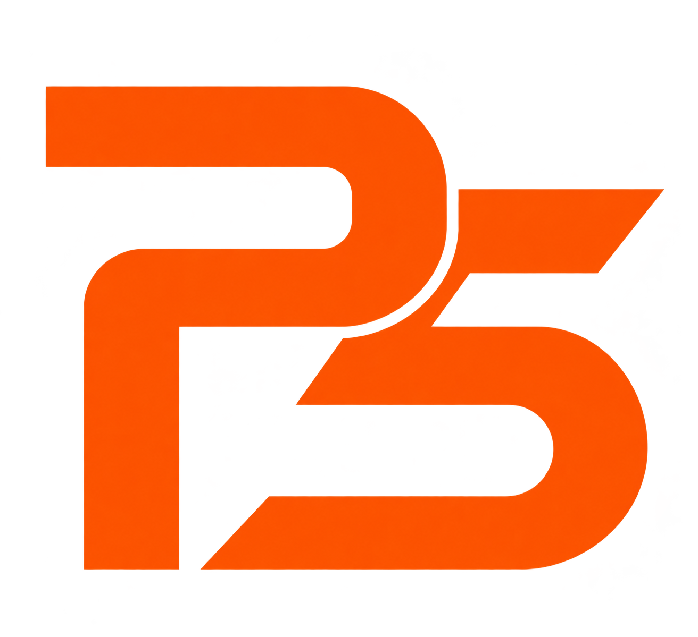
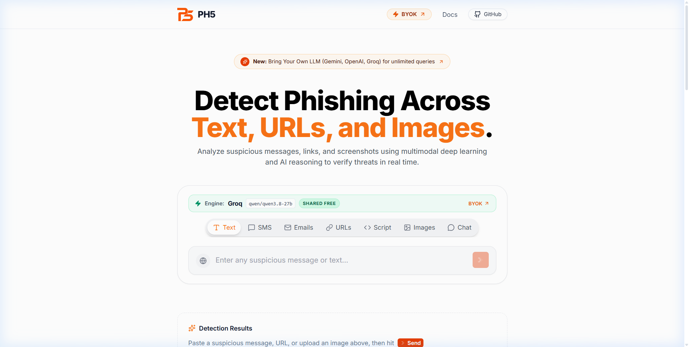
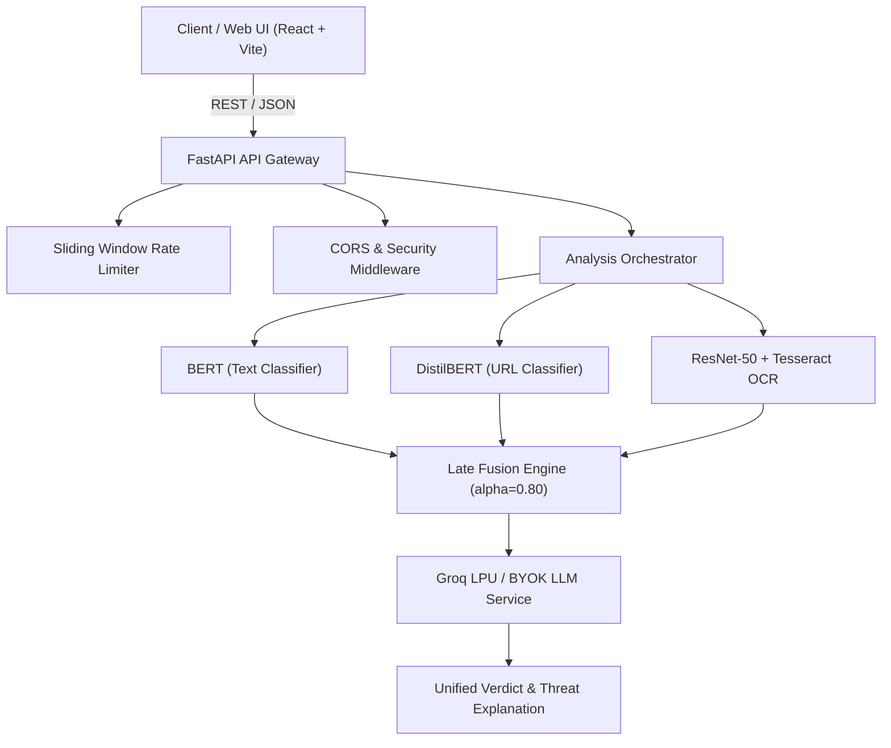

<div align="center">

  <a href="https://github.com/XynaxDev/multimodal-phishing-detector">
    
  </a>

  <br />

  <h1>PH5 Multimodal Phishing Detector</h1>
  <p>
    <strong>Advanced multimodal cybersecurity platform detecting phishing threats across Text, URLs, and Visual Screenshots.</strong>
  </p>

  <p>
    <a href="https://github.com/XynaxDev/multimodal-phishing-detector/actions"></a>
    <a href="https://www.python.org/downloads/release/python-3120/"></a>
    <a href="https://fastapi.tiangolo.com/"></a>
    <a href="https://react.dev/"></a>
    <a href="https://pytorch.org/"></a>
    <a href="https://huggingface.co/"></a>
    <a href="https://tailwindcss.com/"></a>
    <a href="https://docker.com/"></a>
    <a href="LICENSE"></a>
  </p>

  <p>
    <a href="#-overview">Overview</a> •
    <a href="#-interactive-api-documentation">API Reference</a> •
    <a href="#-model-performance--benchmarks">Benchmarks</a> •
    <a href="#-byok-bring-your-own-key">BYOK Engine</a> •
    <a href="#-getting-started">Getting Started</a> •
    <a href="#-deployment">Deployment</a>
  </p>

  <br />

  

</div>

---

## 🚀 Overview

**PH5** is an enterprise-grade multimodal phishing detection platform. Attackers rarely rely on single attack vectors—modern phishing campaigns blend deceptive email wording, spoofed domains, and pixel-perfect screenshot brand impersonation.

PH5 analyzes and fuses signals across three core modalities simultaneously:

1. **Text Modality**: Fine-tuned **BERT** for detecting social engineering, urgency, credential harvesting, and suspicious wording in Emails, SMS, and messaging threads.
2. **URL Modality**: **DistilBERT** 3-class classifier classifying links into **Benign**, **Phishing**, or **Malware** with **99.50%** accuracy.
3. **Visual Modality**: **ResNet-50** deep convolutional network inspecting screenshot page structure, coupled with **Tesseract OCR** for automated text extraction from image captures.
4. **Late Fusion Architecture**: Calibrated fusion algorithm ($\alpha = 0.80$) reconciling individual probabilities into a single, high-confidence phishing verdict.
5. **Generative Reasoning Engine**: Powered by **Groq LPU** (Qwen 2.5 / 3.8 27B) and extensible via **BYOK (Bring Your Own Key)** for instant, human-readable threat explanations.

---

## 📊 Model Performance & Benchmarks

Evaluation results conducted across held-out test splits:

| Modality | Model Architecture | Accuracy | Precision | Recall | F1 Score | Key Benchmark |
|:---|:---|:---:|:---:|:---:|:---:|:---|
| **URL** | **DistilBERT (3-Class)** | **99.50%** | **99.49%** | **99.49%** | **99.49%** | 22,182 test URLs (Tranco, PhishTank, URLhaus) |
| **Text** | **Fine-Tuned BERT** | **97.22%** | **97.51%** | **95.84%** | **96.67%** | ROC-AUC: **0.9961** across SMS/Email datasets |
| **Visual** | **ResNet-50 + OCR** | **78.99%** | **72.69%** | **82.63%** | **77.34%** | Best validation accuracy: **83.30%** |

### URL 3-Class Breakdown

| Class | Precision | Recall | F1 Score | Test Samples |
|---|:---:|:---:|:---:|:---:|
| **Benign** | 99.64% | 100.00% | 99.82% | 7,500 |
| **Phishing** | 99.18% | 99.43% | 99.30% | 7,182 |
| **Malware** | 99.65% | 99.05% | 99.35% | 7,500 |

---

## 🛠️ Tech Stack



* **Backend**: FastAPI 0.115, Pydantic v2, Uvicorn, Python 3.10+
* **Deep Learning**: PyTorch 2.2, Torchvision 0.17, Hugging Face Transformers 4.40
* **Vision & OCR**: Pillow, Tesseract OCR (`pytesseract`), OpenCV
* **LLM Reasoning**: Groq SDK / OpenAI-compatible API (`qwen/qwen3.8-27b`, Llama 3)
* **Frontend**: React 18, Vite, Tailwind CSS 3.4, Framer Motion, Lucide Icons, Shadcn UI
* **Deployment**: Docker, Render (Backend Web Service), Vercel (Frontend SPA)

---

## 📡 Interactive API Documentation

All routes are versioned under `/api/v1` and document full interactive Swagger schemas at `/docs`.

### Base URLs
* **Live Web App**: [`https://ph5-live.vercel.app`](https://ph5-live.vercel.app)
* **Production API**: [`https://ph5-api.onrender.com/api/v1`](https://ph5-api.onrender.com/api/v1)
* **Interactive Swagger Docs**: [`https://ph5-api.onrender.com/docs`](https://ph5-api.onrender.com/docs)
* **Local Development**: `http://localhost:8000/api/v1`

---

### 1. Text Analysis (`/analyze/text`)
Classifies messages, SMS, or emails for social engineering cues.

* **Method**: `POST`
* **Endpoint**: `/api/v1/analyze/text`
* **Headers**: `Content-Type: application/json`

#### Request Payload
```json
{
  "text": "URGENT: Your account has been suspended due to suspicious activity. Verify immediately: http://phish-secure-login.com"
}
```

#### Response (`200 OK`)
```json
{
  "mode": "text",
  "label": "phishing",
  "phishing_score": 0.982,
  "probs": {
    "benign": 0.018,
    "phishing": 0.982
  },
  "explanation": "High-urgency language combined with an unverified credential verification link mimics a standard banking impersonation attack.",
  "explanation_source": "llm",
  "latency_ms": 142.5,
  "llm_provider": "groq",
  "llm_model": "qwen/qwen3.8-27b",
  "cooldown_remaining": 0
}
```

---

### 2. URL Threat Classification (`/analyze/url`)
Performs 3-class classification (`benign`, `phishing`, `malware`) on raw URLs.

* **Method**: `POST`
* **Endpoint**: `/api/v1/analyze/url`
* **Headers**: `Content-Type: application/json`

#### Request Payload
```json
{
  "url": "https://paypal-security-check-verification.com/signin"
}
```

#### Response (`200 OK`)
```json
{
  "mode": "url",
  "url": "https://paypal-security-check-verification.com/signin",
  "label": "phishing",
  "phishing_score": 0.994,
  "probs": {
    "benign": 0.003,
    "phishing": 0.994,
    "malware": 0.003
  },
  "explanation": "Domain incorporates high-risk financial brand keywords with deceptive subdomain staging.",
  "explanation_source": "llm",
  "latency_ms": 118.0,
  "llm_provider": "groq",
  "llm_model": "qwen/qwen3.8-27b",
  "cooldown_remaining": 0
}
```

---

### 3. Screenshot & Image Analysis (`/analyze/image`)
Runs visual inspection via ResNet-50 and extracts embedded text with OCR.

* **Method**: `POST`
* **Endpoint**: `/api/v1/analyze/image`
* **Headers**: `Content-Type: multipart/form-data`

#### cURL Example
```bash
curl -X POST "http://localhost:8000/api/v1/analyze/image" \
  -F "file=@screenshot.png"
```

#### Response (`200 OK`)
```json
{
  "mode": "image",
  "label": "phishing",
  "phishing_score": 0.887,
  "probs": {
    "benign": 0.113,
    "phishing": 0.887
  },
  "ocr": "Sign in to your Microsoft Account. Password: ...",
  "explanation": "Visual layout replicates a corporate login page; OCR detects credential collection forms on an unauthorized host.",
  "explanation_source": "llm",
  "latency_ms": 482.3,
  "llm_provider": "groq",
  "llm_model": "qwen/qwen3.8-27b",
  "cooldown_remaining": 0
}
```

---

### 4. Multimodal Late Fusion (`/analyze/multimodal`)
Accepts text, URL, and screenshot simultaneously and applies calibrated late fusion.

* **Method**: `POST`
* **Endpoint**: `/api/v1/analyze/multimodal`
* **Headers**: `Content-Type: multipart/form-data`

#### cURL Example
```bash
curl -X POST "http://localhost:8000/api/v1/analyze/multimodal" \
  -F "text=Verify your banking profile immediately" \
  -F "url=http://secure-login.bank-update.xyz" \
  -F "file=@login_page.png"
```

#### Response (`200 OK`)
```json
{
  "mode": "multimodal",
  "label": "phishing",
  "phishing_score": 0.978,
  "fused_probability": 0.978,
  "explanation": "Multi-signal correlation confirmed malicious intent: text demonstrates coercive urgency, URL is hosted on an unverified TLD, and image exhibits fraudulent branding.",
  "explanation_source": "llm",
  "latency_ms": 612.8,
  "modality_results": {
    "text": { "label": "phishing", "phishing_score": 0.982 },
    "url": { "label": "phishing", "phishing_score": 0.994 },
    "image": { "label": "phishing", "phishing_score": 0.887 }
  }
}
```

---

### 5. Conversational Cyber Assistant (`/chat`)
Interactive AI assistant with intent auto-classification.

* **Method**: `POST`
* **Endpoint**: `/api/v1/chat`
* **Headers**: `Content-Type: multipart/form-data`

```bash
curl -X POST "http://localhost:8000/api/v1/chat" \
  -F "query=Is this email legit? It says my package is delayed: http://track-dhl-delivery.net"
```

---

### 6. Diagnostics & System Health

| Endpoint | Method | Description |
|---|:---:|---|
| `/api/v1/health` | `GET` | Container liveness check (`{"status": "ok", "version": "2.0.0"}`) |
| `/api/v1/status` | `GET` | Model caching status and active LLM configuration |
| `/api/v1/llm/models` | `GET` | Fetches models supported by a provider (Gemini, Groq, OpenAI, OpenRouter) |
| `/api/v1/llm/verify` | `POST` | Validates user-supplied BYOK API keys with live handshakes |

---

## 🔑 BYOK (Bring Your Own Key) Engine

PH5 provides a complete client-side BYOK subsystem allowing users to connect their own LLM keys directly without storing secrets on our database.

### Supported Providers
* **Groq LPU**: `qwen/qwen3.8-27b`, `llama-3.3-70b-versatile`, `llama-3.1-8b-instant` *(Free)*
* **Google Gemini**: `gemini-2.5-flash`, `gemini-1.5-pro` *(Free tier)*
* **OpenRouter**: Free and paid models (`meta-llama/llama-3.3-70b-instruct`, `deepseek/deepseek-chat`)
* **OpenAI**: `gpt-4o-mini`, `gpt-4o`
* **Custom / Local**: Ollama, vLLM, LM Studio via custom `base_url`

### Using BYOK in Custom API Calls
Simply append standard headers to any `/api/v1/analyze/*` or `/api/v1/chat` request:

```http
POST /api/v1/analyze/text HTTP/1.1
Host: localhost:8000
Content-Type: application/json
X-LLM-Provider: groq
X-LLM-Api-Key: gsk_yourPersonalKeyHere
X-LLM-Model: qwen/qwen3.8-27b
```

---

## 💻 Getting Started

### Prerequisites
* Python 3.10+ (Python 3.12 recommended)
* Node.js 18+ & npm
* Tesseract OCR *(Optional, for local screenshot OCR)*

---

### 1. Backend Setup

```powershell
# 1. Clone repository
git clone https://github.com/XynaxDev/multimodal-phishing-detector.git
cd multimodal-phishing-detector/backend

# 2. Create virtual environment
python -m venv .venv
.\.venv\Scripts\Activate.ps1   # Windows
# source .venv/bin/activate    # Linux / macOS

# 3. Install CPU-optimized PyTorch first
pip install torch torchvision --index-url https://download.pytorch.org/whl/cpu

# 4. Install backend dependencies
pip install -r requirements.txt

# 5. Configure environment variables
copy .env.example .env

# 6. Start development server
uvicorn app.main:app --reload --port 8000
```

Verify backend:
* Interactive Swagger Docs: [http://localhost:8000/docs](http://localhost:8000/docs)
* Health Check: [http://localhost:8000/api/v1/health](http://localhost:8000/api/v1/health)

---

### 2. Frontend Setup

```powershell
# In a new terminal, navigate to frontend/
cd ../frontend

# Install dependencies
npm install

# Start Vite dev server
npm run dev
```

Open [http://localhost:5173](http://localhost:5173) in your browser.

---

### 3. Running with Docker

The project includes an optimized multi-stage `Dockerfile`:

```bash
# Build production Docker image
docker build -t ph5-backend ./backend

# Run container
docker run -p 8000:8000 \
  -e GROQ_API_KEY="your_groq_key" \
  -e ENVIRONMENT="production" \
  ph5-backend
```

---

## 🚢 Deployment

Detailed step-by-step production deployment instructions are documented in [`docs/DEPLOYMENT.md`](docs/DEPLOYMENT.md).

* **Live Web Dashboard**: Hosted on **Vercel** at [`https://ph5-live.vercel.app`](https://ph5-live.vercel.app).
* **Production API**: Hosted on **Render** at [`https://ph5-api.onrender.com`](https://ph5-api.onrender.com) (Swagger Docs: [`/docs`](https://ph5-api.onrender.com/docs)).
* **Model Distribution**: Quantized INT8 ONNX & PyTorch checkpoints distributed via [Hugging Face Model Hub](https://huggingface.co/xynaxdev).

---

## 📂 Repository Structure

```
multimodal-phishing-detector/
├── backend/
│   ├── app/
│   │   ├── main.py              # Application lifecycle & middleware setup
│   │   ├── schemas.py           # Pydantic v2 validation models
│   │   ├── core/                # Config, custom error handling & rate limiter
│   │   │   ├── config.py
│   │   │   ├── errors.py
│   │   │   ├── logging.py
│   │   │   └── rate_limit.py
│   │   ├── api/                 # Versioned REST routers & dependencies
│   │   │   ├── router.py
│   │   │   ├── deps.py
│   │   │   └── routes/
│   │   │       ├── analyze.py   # /analyze/text, /url, /image, /multimodal
│   │   │       ├── chat.py      # /chat conversational intent engine
│   │   │       ├── llm_verify.py# /llm/models and /llm/verify handshake
│   │   │       ├── system.py    # /health and /status probes
│   │   │       └── legacy.py    # Backward-compatible API aliases
│   │   └── services/            # Core inference & ML business logic
│   │       ├── model_registry.py# Thread-safe weights cache & HF Hub loader
│   │       ├── inference.py     # PyTorch BERT, DistilBERT, ResNet-50
│   │       ├── fusion.py        # Calibrated late fusion engine
│   │       ├── llm.py           # Groq & BYOK multi-provider LLM client
│   │       ├── ocr.py           # Tesseract OCR extraction service
│   │       └── analysis.py      # Main analysis orchestrator
│   ├── tests/                   # Automated pytest suite
│   ├── Dockerfile               # Production container image
│   └── requirements.txt         # Inference dependencies
├── frontend/
│   ├── src/
│   │   ├── components/          # Premium UI components (SearchBar, InferencePanel)
│   │   ├── pages/               # DocsPage, NotFoundPage
│   │   ├── api.js               # Centralized Axios client & BYOK interceptors
│   │   └── styles.css           # Tailored typography & design tokens
│   ├── public/                  # Brand assets (logo, monogram, previews)
│   ├── vercel.json              # Vercel SPA rewrite rules
│   └── package.json
├── ml/                          # Model training & cross-validation scripts
├── docs/                        # Private documentation & research assets (local)
├── render.yaml                  # Render Blueprint definition
└── README.md
```

---

## 🤝 Contributing

Contributions, bug reports, and suggestions are welcome! Please check out [CONTRIBUTING.md](CONTRIBUTING.md) before submitting a Pull Request.

1. Fork the Project
2. Create your Feature Branch (`git checkout -b feature/AmazingFeature`)
3. Commit your Changes (`git commit -m 'Add some AmazingFeature'`)
4. Push to the Branch (`git push origin feature/AmazingFeature`)
5. Open a Pull Request

---

## 📄 License

Distributed under the **MIT License**. See [`LICENSE`](LICENSE) for more information.

---

<div align="center">

  **Engineered with care ⚡ by Akash Kumar Sah**

  *If you find this project valuable, please consider giving it a ⭐ on GitHub!*

</div>